# Catalogue-composed evidence reviews

An optional **Layer 3 client composition** discovers published evidence-review procedures, explains which whole procedure exactly fits a task, renders an HMD review, and executes the reviewed signed request with the existing read-only runner. The same integration runs the existing performance/learning review and an independent organizational-decision review. It adds no core tool, service endpoint, deployment dependency or model callback.

Development is tracked in [issue #755](https://github.com/markjspivey-xwisee/interego/issues/755). Owner-agent coordination and resumable project state live in the Interego graph `urn:graph:project:interego:work:procedure-composition-20261103`; operational sources and journals remain encrypted/shared with the owner's authorized agents rather than being committed here.

## The actual composition

```mermaid
flowchart LR
  T[Task and explicit catalogue trust bindings] --> H[HyprCat catalogue heads and signed products]
  H --> D[Existing DifferentialKernel]
  D --> R[Canonical HMD review and exact invocation digest]
  R --> F[Fresh discovery and signed request verification]
  F --> P[Existing directed RDF procedure runner]
  P --> C[Final catalogue and domain source checks]
  C --> O[HMD result and durable private journal]
```



| Existing component | What this integration reuses |
| --- | --- |
| [HyprCat](../../docs/ns/hyprcat.ttl) and [FOXXI catalogue pattern](../../applications/foxxi-content-intelligence/src/course-catalog-product.ts) | Federated catalogues, issuer/world declarations, typed data products, output ports and peer links. The new bounded parser interprets a local procedure profile using the existing core Turtle parser; it does not import the course-specific parser. |
| [Differential Reuse kernel](../affordance-surface/differential-kernel.ts) | Exact triple/variable alignment, preserved invariants, proposed additions, unexplained task triples, candidate frontier and resolution policy. The kernel is unchanged. |
| [HMD](../../packages/core/src/kernel/hypermedia-markdown.ts) | Canonical renderer/parser, typed authority links, review digest, directed-step navigation and result representation. No custom viewer or invented Run control. |
| [Procedure runner](../procedure-runner/README.md) | Signed native RDF request and procedure loading, current-head pins, finite directed steps, declared checks and decision boundary, read-only controls, source projection and execution metrics. The runner is unchanged. |
| [Organizational working memory](../../applications/organizational-working-memory/src/pod-publisher.ts) | Existing `owm:Decision`, `owm:concernsProject`, title and rationale shape, with a `dct:source` citation. The domain adapter prepares a signed JSON projection using the already-supported application document format. It does not call the OWM bridge or claim to evaluate a rationale. |

Only whole-procedure reuse is executable in this first composition. A candidate must cover the three task triples exactly, with zero proposed additions or unexplained triples. An equal match requires an explicit product choice. Partial matches remain visible differences for host review. DifferentialKernel's heuristic score and default evidence prior are not measured reliability. This integration does not execute a graft or treat the kernel's first invocation as an arbitrary multi-step plan.

## Trust and review

The host explicitly supplies each catalogue's pod, graph IRI, issuer and trusted signer. `hyprcat:federatedWith` traverses only that allowlist; a discovered peer never grants trust. A catalogue is loaded from its current unambiguous head and requires the expected signer plus verified graph and descriptor-location binding. Products must match its issuer, agent world and installed read-procedure profile, and name absolute domain, goal and procedure IRIs (a relative domain or goal IRI such as `<?d>` would otherwise read as a kernel variable; a relative procedure IRI would fail later with a misleading error). Its output port advertises a GET of the signed request, not remote code or a server-side execution operation.

The review digest covers the task, all observed catalogue heads and trust bindings, selected product, parsed invocation inputs and compiled procedure. The review HMD shows the task, each observed catalogue's trust binding and head CID, any untrusted peers, the procedure pin and every invocation input as table cells, each value one code span (a value containing a backtick, which no IRI can, falls back to backslash escapes; the HMD widget still applies its link and `*` emphasis patterns inside a code span); the separate procedure HMD shows the compiled steps. Execution repeats discovery and refuses a changed digest. It rechecks request/procedure contents during bootstrap and fences catalogue heads before returning completion. Domain procedures independently fence their own evidence. These sampled checks provide no transaction or lock across services.

Signatures and binding are verified by the authenticated Interego host. The current live deployment supplies relay-signed attribution attestations; these are not signatures made by the caller's own private key. The digest and local journal hash chain are not signatures, credentials or recipient-access proofs. Use the host's real audience metadata rather than an HMD display label to establish sharing scope.

## Run offline

From a normal checkout with Node 22:

```sh
npm ci --ignore-scripts
npm run build:core
node --import tsx --test integrations/procedure-composition/*.test.mjs integrations/procedure-runner/*.test.mjs
node --import tsx integrations/procedure-composition/demo.mjs NEW_PRIVATE_PROOF_DIRECTORY
```

The demo runs preparation and execution in separate CLI processes for each domain, returning actual host responses from an explicitly offline fixture. The existing 28-step learning RDF is loaded unchanged and checks its performance/SCORM/xAPI bindings. The independent 16-step organizational RDF checks the packet's cited source (whose citation the packet publisher checked), trusted signer, exact source projection and both current heads, then rechecks those heads. It has no learning or FOXXI dependency. Tests also run it with only the organizational catalogue installed.

Fixture signatures, assessments, course and statement identifiers are not real-world evidence. Offline results establish functional reuse and failure handling, not live domain outcomes or competitive superiority.

## Run through an authenticated Interego host

Prepare domain data outside the read-only routine. For organizational review, publish a native OWM decision and its cited evidence with the existing `publish_context`; resolve each committed head and read its signed graph back. `prepareDecisionPacket` accepts these explicit observed references, verifies the decision's project and citation in RDF, and produces publication data using the existing signed-JSON format. Publish that packet, the [domain procedure](../../examples/procedures/organizational-evidence-review.ttl), and a signed invocation using `renderRunRequest`. Use observed committed CIDs rather than provisional publication values. Publish its HyprCat product using `renderCatalog`.

The caller must trust the packet publisher's domain projection. Execution checks the exact selected source content, authority and freshness; it does not independently derive the packet's interpretation or establish that the decision was approved or its rationale is sound.

Configuration is a bounded JSON file containing only `task`, `catalogs`, `seeds`, and optional `selectedProductId`. All values below are placeholders:

```json
{
  "task": { "domain": "urn:domain:organizational-memory", "goal": "urn:goal:evidence-review" },
  "catalogs": [{
    "graphIri": "urn:example:procedure-catalogue",
    "podUrl": "https://example.invalid/pod/",
    "issuer": "https://example.invalid/owner#me",
    "trustedSigner": "did:example:explicitly-trusted-author"
  }],
  "seeds": ["urn:example:procedure-catalogue"]
}
```

```sh
node --import tsx integrations/procedure-composition/stdio.mjs prepare CONFIG.json NEW_PRIVATE_PREPARATION_DIRECTORY
node --import tsx integrations/procedure-composition/stdio.mjs execute CONFIG.json NEW_PRIVATE_EXECUTION_DIRECTORY REVIEWED_DIGEST
```

The CLI uses the [existing runner's JSON-lines host protocol](../procedure-runner/README.md#run-with-an-existing-authenticated-mcp-host). Forward its requested operation to your existing authenticated Interego connection and return that actual MCP result unchanged. Keep stdin open; an unknown transport outcome is retained and never automatically retried. The CLI creates exclusive, fsynced, hash-chained events and writes the HMD and JSON result. Use an owner-protected directory; POSIX file modes alone do not configure Windows ACLs. Journals contain underlying evidence and should remain private.

The programmatic entry points are `prepareComposition(options)` and `executeComposition({ ...options, reviewDigest })`. Both require the host's authenticated `call` and durable `onEvent`. Expected uncertainty returns `needs-decision` or the domain's blocked result. Malformed authority, changed bootstrap content, storage failure and unavailable transport may reject; the host must retain the journal and report the interruption.

## Evidence and scope

[proof-results.json](proof-results.json) records aggregate functional observations. Private operational descriptors, content, request values and journals are not included in the public repository. Existing benchmark results are unchanged.

The first live organizational demonstration uses the owner's actual project-scope decision and signed Interego evidence. It reviews existing project facts; it does not perform a business approval or establish a rationale's quality. The catalogue traversal is between two catalogues on one owner pod, not a demonstration of cross-owner federation. The learning procedure has an earlier published live demonstration documented by its own runner; this composition's learning proof is an offline replay, not a new production assessment.

This first composition has no writes inside its routine, crash-resume cursor, arbitrary procedure synthesis, multi-authority write coordination, product-level UI or comparative cost/latency measurement. Those require separate evidence and domain contracts. Any domain can supply another explicitly installed procedure product and signed request without changing this integration or core.
